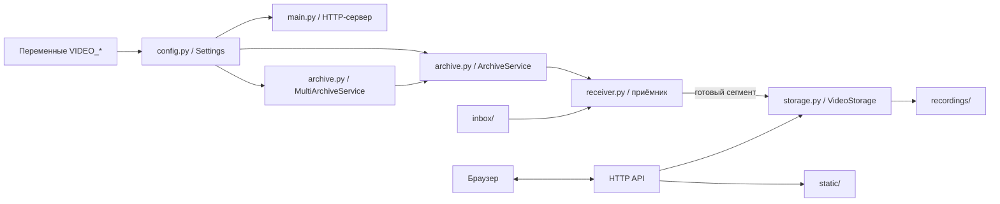
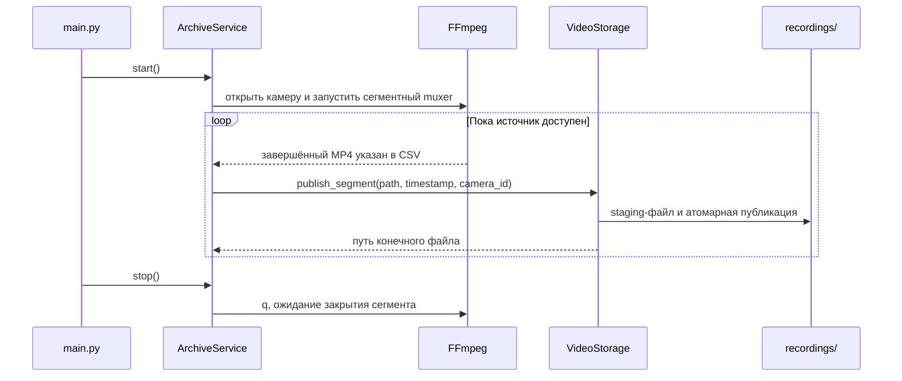

# Архитектура и внутреннее устройство

Документ описывает фактическое устройство сервиса: где он принимает источник, как формирует часовые MP4, как публикует файлы в архив и как отдаёт их браузеру.

## Компоненты



### `config.py`

`Settings.from_env()` читает параметры `VIDEO_*`, проверяет допустимые значения и создаёт объект настроек. Относительные пути считаются от текущей рабочей папки процесса, а абсолютные пути используются как заданы. Для нескольких сетевых камер `VIDEO_CAMERAS` разбирается как JSON-массив. Каждая камера получает отдельный `ArchiveService`, но все они используют общий объект `VideoStorage` и общий архив.

### `main.py`

`run()` создаёт хранилище, выбирает одиночный `ArchiveService` или `MultiArchiveService`, запускает приёмники и затем HTTP-сервер на `VIDEO_HOST:VIDEO_PORT`. HTTP-сервер построен на стандартном `ThreadingHTTPServer`: запросы обрабатываются отдельными потоками.

При завершении по `Ctrl+C` или `SIGTERM` HTTP-сервер закрывается и вызывается остановка сервиса архива. При `VIDEO_HOST`, отличном от локального loopback, в журнал выводится предупреждение о сетевой доступности.

### `archive.py`

- `ArchiveService` управляет одним приёмником: запускает фоновый поток, передаёт завершённые сегменты в `VideoStorage`, хранит последнюю ошибку и повторяет подключение после сбоев с задержкой `VIDEO_RETRY_SECONDS`.
- `MultiArchiveService` создаёт по `ArchiveService` на каждый элемент `VIDEO_CAMERAS`. У каждого потока свой `camera_id`, `thread`, событие остановки и временная подпапка `VIDEO_TEMP_DIR/<camera_id>`. Готовые сегменты всех камер публикуются в один `VIDEO_RECORDINGS_DIR`.
- Состояние одной камеры: `running`, `degraded`, `stopped` или `disabled`. Агрегированное состояние нескольких камер `running`, когда работают все; `stopped`, когда остановлены все; в остальных сочетаниях — `degraded`.
- При старте приёмника и после успешной публикации ошибки камеры очищаются. Между потерей связи и успешным переподключением состояние становится `degraded`.

### `receiver.py`

Содержит три типа источника.

- `FfmpegUrlSource` открывает RTSP/HTTP(S)-адрес через FFmpeg. Для RTSP используется TCP. `VIDEO_SOURCE_TIMEOUT_SECONDS` передаётся как сетевой таймаут чтения FFmpeg.
- `SyntheticSource` генерирует тестовую картинку и звук с помощью FFmpeg; он не обращается к камере и требует в FFmpeg кодировщики `libx264` и AAC.
- `InboxReceiver` наблюдает за папкой готовых файлов и выдаёт подходящий MP4 для импорта.

`FfmpegSegmentReceiver` формирует команду FFmpeg. По умолчанию он отображает потоки входа `-map 0` и копирует кодеки без перекодирования (`-c copy`). Сегментный muxer использует `VIDEO_SEGMENT_SECONDS`, привязку к локальному времени, сброс временных меток и CSV-список завершённых сегментов. Временное имя содержит время сегмента и случайный ID запуска FFmpeg.

Приёмник опрашивает список завершённых файлов примерно четыре раза в секунду. Только перечисленные FFmpeg как завершённые непустые MP4 передаются архиву. После завершения сегмента вызывается callback публикации; открытый или аварийно незакрытый файл в архив не попадает.

При штатной остановке приёмник отправляет FFmpeg команду `q`, ждёт до 10 секунд, затем при необходимости завершает процесс и после дополнительного таймаута принудительно останавливает его. Незавершённые файлы и временный CSV-список очищаются.

### `storage.py`

`VideoStorage` создаёт каталоги, валидирует имена, проверяет свободное место, импортирует готовые файлы, публикует сегменты и перечисляет архив. Длительность готового MP4 запрашивается у `ffprobe`; результат кэшируется по пути, времени изменения и размеру файла.

Публикация выполняется так:

1. Проверяются имя, существование и ненулевой размер исходного MP4.
2. Проверяется, что после записи останется не менее `VIDEO_MIN_FREE_BYTES` свободного места.
3. Данные копируются во временный файл внутри каталога архива, записываются на диск через `flush`/`fsync`.
4. В том же каталоге создаётся жёсткая ссылка с конечным именем. Такой шаг атомарно публикует файл и отказывается перезаписывать уже существующую запись.
5. Временная копия удаляется; исходный сегмент удаляется после успешной публикации.

Обычный режим хранения не удаляет старые архивные файлы автоматически. За свободным местом и резервным копированием должен следить оператор.

## Жизненный цикл сетевой записи



Каждая камера работает в отдельном потоке и с отдельной временной папкой. Это позволяет нескольким FFmpeg-процессам писать параллельно, не используя общие временные списки. Общий каталог `recordings/` обеспечивает один список в интерфейсе.

## Режим передачи готовых файлов

`InboxReceiver` проверяет входную папку примерно каждые 0,5 секунды. Он рассматривает только файлы `.mp4` с допустимым именем. Файл готов к импорту, если рядом появился маркер `имя.mp4.ready` или его размер и время изменения не менялись заданное число секунд.

После успешной атомарной публикации исходный файл и маркер `.ready` удаляются. Если публикация не прошла, например из-за конфликта имени или нехватки места, исходный файл остаётся во входной папке и попытка повторяется после паузы. В режиме `inbox` сервис не разбивает файл на части и не перекодирует его.

## Имена и время

Формат архивного имени:

```text
YYYY-MM-DD_HH-MM-SS.mp4
YYYY-MM-DD_HH-MM-SS__camera-id.mp4
```

Часть после `__` — идентификатор камеры. Он необходим для различения одновременно записываемых потоков, попадает в поле `camera_id` API и используется как заголовок группы в веб-интерфейсе. Допустимы латинские буквы и цифры, точка, дефис и подчёркивание; ID должен начинаться с буквы или цифры и иметь длину не более 64 символов.

Для стандартного интервала 3600 секунд FFmpeg выравнивает сегменты по локальным часовым границам. Реальный момент закрытия зависит от ключевых кадров входного видео, поэтому граница сегмента может немного отличаться от точного часа. При осеннем переводе часов локальное время может повториться; одинаковые имена не перезаписываются.

## Составные ограничения

- Сервис копирует исходный видеопоток без перекодирования. Совместимость готового MP4 с браузером зависит от кодека камеры.
- Несколько сетевых камер настраиваются через `VIDEO_CAMERAS`; каждое соединение использует отдельный процесс FFmpeg. Требования к сети, CPU и диску растут с количеством потоков.
- `VIDEO_SOURCE=inbox` — один наблюдаемый каталог. Идентификатор источника для готового файла берётся из его имени, а не из настроек сетевых камер.
- У веб-интерфейса и API нет аутентификации, TLS и управления камерами. По умолчанию сервер привязан к локальному компьютеру.
